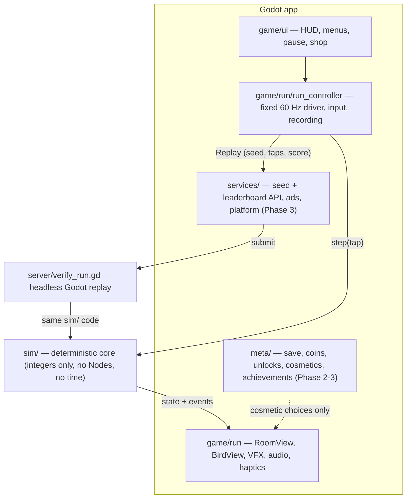

# Flapjaw — Architecture

Godot 4 (GDScript), portrait mobile game for iOS and Android, with verified
leaderboards that re-simulate every submitted run on a server.

The whole design follows from one requirement: **a run is fully described by
`(gameplay_version, seed, tap ticks)`**. Same inputs give the same score on every
phone and on the server. Everything else (art, characters, themes, sound, menus)
is presentation that can never change the outcome.

Class diagrams for rooms, obstacles, themes, cosmetics, meta and server:
[DOMAIN_MODEL.md](DOMAIN_MODEL.md).

## Layers



| Folder | Owns | May depend on | Must never |
|---|---|---|---|
| `sim/` | Physics, collision, room generation, scoring, RNG, replay/verify | nothing outside `sim/` | Use floats, `Vector2`, `randf/randi`, `Time`, `OS`, `Engine`, Nodes, frame delta, character/theme data |
| `game/` | Scenes, drawing, input, audio, haptics, UI | `sim/`, `meta/`, `services/` | Write to sim state; put gameplay rules here |
| `meta/` | `Profile` (save file: coins, owned, equipped, first start), `Shop` (prices, buying), `Catalog` (flyers, worlds, trails, exit portal looks, music, crash effects, name plates). Later: achievements, ranks | `sim/` (read events) | Change gameplay |
| `meta/` (economy) | `Economy` (gold and diamonds: 1 diamond = 100 gold, one way; daily top-10 prizes), `DiamondPacks` (what real money buys), `Shop.diamond_price` (premium worlds and listed premium items sell for diamonds). Proposal: https://claude.ai/artifact/2bA62CLfPznF1fgs3BqCqG | — | Sell anything that changes a run |
| `services/` (store) | `StoreService` (closed store in release builds until app-store billing exists), `SampleStore` (debug builds and tests: pays at once). `WalletService` (diamonds in the save) and `SupabaseWallet` (diamonds on the server: balance, daily top-10 payout and claim, every spend; supabase/migrations/20261110100000_diamonds.sql). Still to come: store receipts checked on the server, owned items on the server, lost-spot alerts | — | Grant diamonds without the store's confirmation |
| `services/` | `LeaderboardService` (screens only talk to this; `SampleLeaderboard` serves made-up boards until the server exists). Later: HTTP to seed/leaderboard server, ads, Game Center / Play Games mirror | — | Hold game rules |
| `data/` | `design/`: the design kit's tokens + extra palettes and worlds; `themes/`: generated `ThemeDef` per world. Later: characters, hats, trails | — | Hold hitbox or physics values |
| `assets/` | SVG icons and UI art, fonts | — | — |
| `server/` | Headless verifier; later the cloud wrapper around it | `sim/` | Fork the sim (it runs the same files) |
| `tests/` | Unit tests, golden replays, bot simulations | everything | — |
| `tools/` | `check.ps1`, CI helpers, golden-replay generator | everything | — |

`tests/unit/test_sim_purity.gd` enforces the `sim/` rules by scanning the source,
so breaking them fails the check script.

## Deterministic core (`sim/`)

- **Fixed tick**: 60 ticks/second. `GameSim.step(tap: bool)` advances exactly one
  tick. The sim has no idea how much real time passed.
- **Integer math only**: positions and velocities are integers in sub-units
  (`SimConfig.SUB = 64` per logical pixel). Integer math gives the same result on
  every CPU; floating point and trig functions are not guaranteed to.
- **Own RNG**: `SimRng` is xoshiro128** on 32-bit masked ints, seeded from the run
  seed. The draw order is part of the gameplay rules. A cross-language reference
  test pins its output.
- **World**: 360 × 640 logical pixels. Ceiling and floor are always deadly. Side
  walls have 13 spike slots stored as bitmasks (`left_spikes`, `right_spikes`).
- **Loop**: bird flies sideways at constant speed, a tap sets an upward velocity,
  gravity pulls down. Hitting a side wall scores a point, clears that wall and
  generates spikes on the opposite wall. Every 10 points the run moves to a new
  room kind.
- **Room generation** (`RoomRules`) always leaves a guaranteed gap of free slots.
  The spike count grows with score.
- **Events**: each step fills `GameSim.events` (`START`, `FLAP`, `BOUNCE`,
  `SCORE`, `ROOM_CHANGE`, `DEATH`). The view layer turns these into sound,
  haptics, particles and screen shake. The sim never calls out.
- **Checksum**: `SimState.checksum()` hashes the full state. Golden replays store
  it, so even a change that keeps the score but moves the bird is caught.
- **Same hitbox for every character**: character and theme never enter the sim,
  so scores stay comparable and replays don't depend on cosmetics.

### Rooms

Every 10 points an exit portal opens on the wall the bird is heading to (a
random spike slot; no spikes in the opening, and the whole spike-free gap
around the portal leads through, so there is no strip to bounce in beside it). Flying into it moves to the next room;
missing it is a normal bounce and it stays open. The bird comes out of a portal
in the opposite wall of the new room at the same height and keeps flying the
same way (gameplay version 6), at full speed with no wait. Instead the room is
laid out for a player who is still reading it (gameplay version 18; it replaced
a frozen wait and then a slow-motion entrance): `ArrivalCheck` plays the
arrival on copies of the sim (`SimCopy`), the bird only holding its height for
`SimConfig.ARRIVAL_BLIND` ticks (1 s, gameplay version 19) and then a few simple players trying
to live `ARRIVAL_FOLLOW` ticks more. If fewer than two do, the layout is drawn again, up to
`ARRIVAL_TRIES` times (each retry skips one RNG draw, so the seed still decides
everything and replays match). Rooms also keep the way out of a portal fair: Floating Isles
keeps the lane in front of it clear (200 px), Pinwheel
and Saw Ring move off the bird's height, Ghost Doors time their fade for it,
Bee Line, Bat Loop, Lantern Swing and Ghost Doors time themselves to the path
of a player holding height (`GameSim.arrival_path`), Shutter Gates has its gap
at the bird's height when it gets there, and a wall the bird reaches while
still reading (fast or narrow rooms) keeps that player's hops free of spikes.
The bird comes out at least `SimConfig.ARRIVAL_EDGE` from the ceiling and
floor lines, so holding height never hops into them. Where no timing can
work, the room isn't picked out of a portal at that height
(`RoomDef.arrival_skip`): rooms with a hazard near the ceiling skip high
arrivals, Bee Line and Lantern Swing skip the middle heights their hazards
sweep. `tools/arrival_test.gd` and `tools/arrival_room.gd`
measure how often a player who reacts late dies right after a portal.
The reaction benchmark: a player who needs 0.75 s is never killed by a
portal (every death there still had a way to live: `SurvivalSearch` finds
one), and a 1 s reaction may cost at most 2% of portal arrivals over an
instant one (`ArrivalBench`, checked by
`tests/sim/test_arrival_reaction.gd`; run the full version on FastSim after
changing a room: `tools/fastsim.ps1 -Mode reaction`, and `-Mode odds` for
survival by reaction time in real runs). Every 50 points a
fork offers a Calm and a Wild exit: the one taken sets the route (Calm: starter,
mid and bonus rooms; Wild: mid and late rooms, plus 3 coins). The next room is
picked by the seed
(`RoomCatalog.pick_next`: weighted, never the same room twice, only rooms whose
`from_score` is reached and whose season matches the run's).

Fairness is checked by `tests/support/survival_search.gd` (SurvivalSearch): it
runs many copies of the sim side by side, tapping and waiting on each, so if all
of them die, no player could have lived. `tools/sweep.ps1` runs it (or the
PlannerBot playtests in `tools/playtest.gd`) over many seeds on every CPU core;
`tests/sim/test_rooms_survivable.gd` keeps the rooms it once caught fixed.

Fairness rules that came out of it (gameplay version 6): in rooms with hazards
the wall's free run lands within `RoomRules.GAP_REACH` of the bird; hazards
placed at room start keep off the bird's first, forced hop
(`GameSim.start_path`) and, where they can, out of a hover lane in front of it
(`GameSim.blocks_start_lane`); paired columns (stalactites, gates) keep their
gaps close and clear the wall ahead near them; the open first room is only the
start and never comes back.

- `sim/rooms/room_def.gd` (RoomDef): what a room is: group, from_score, weight,
  season, wall rules (spike count/gap, tide, blink, squeeze), gravity, speed,
  and the hazards it builds (factories, or `combos` for Double Trouble).
- `sim/rooms/catalog_*.gd`: rooms in batches (core, motion, machines, sky,
  seasonal, combo). `RoomCatalog.BATCHES` fixes the order; append new batches
  at the end.
- `sim/rooms/room_runtime.gd` (RoomRuntime): the live room: steps, points,
  wall position and spike masks over time, steps per tick (fast/slow rooms).
- `sim/rooms/hazard.gd` (Hazard) and `sim/hazards/*.gd`: one class per
  obstacle (setup/step/kills/touch/on_bounce/on_flap/guards_edge/checksum).
  Integer, tick-driven, so replays verify.
- `game/run/hazard_layer.gd` + `game/run/painters/<kind>_painter.gd`: one
  painter per hazard kind; deadly parts in the world's spike color only.
- Seasons (`sim/rooms/seasons.gd`) are a run input: `meta/season_calendar.gd`
  maps today's date to a season, `GameSim`/`Replay` store it.

Adding a room: write the hazard (or reuse one), its painter, a RoomDef in a
batch file, and tests; bump `GAMEPLAY_VERSION` and regenerate goldens.

### Gameplay versions

`SimConfig.GAMEPLAY_VERSION` (currently `3`: the room system) goes up whenever movement,
collision, generation or RNG draw order changes. Golden replays then fail on
purpose. Regenerate them with `tools/make_golden.gd` only after bumping the
version.

When live builds exist, the server must keep replaying older versions that are
still allowed. Plan: before changing the sim, freeze the current files into
`sim/versions/g<N>/` (class names suffixed, e.g. `GameSimG1`), and have
`server/verify_run.gd` dispatch on `gameplay_version`. Retired versions are
rejected and the player is asked to update. Not needed until the first release.

## Client run loop (`game/`)

```
_unhandled_input   tap  -> _tap_pending = true
_physics_process   (60 Hz, fixed)
    tap = _tap_pending; _tap_pending = false
    if tap: replay.taps.append(sim.state.tick)
    sim.step(tap)
    for e in sim.events: emit signals  -> HUD, audio, haptics, VFX
_process           views draw, interpolating between previous and current tick
```

- `RunController` (Node) owns the `GameSim` and the `Replay` being recorded. It is
  the only place that touches the sim.
- `RoomView` / `BirdView` read `sim.state` and draw. Rooms are drawn
  procedurally in the "Soft light" style (gradient sky with blurred patches of
  its own sky stops, one glow bloom, drifting particles, rounded two-tone
  spikes; the ceiling and floor rows are unbroken and reach the kill lines).
  Menus and HUD use the minimal kit (`UiTheme`): ink text straight on the room,
  flat cream cards only for grids and forms, one round main button per screen,
  the cradle dock on Home and Game over, Archivo as the only font. Real sprites
  replace the drawing later without touching the sim.
- Pause just stops calling `step()`. The app auto-pauses when it loses focus.
- Display: 360 × 640 viewport, `canvas_items` stretch with `expand` aspect (no black bars; `game/style/screen_layout.gd` puts the fixed 360 × 640 room at the top of the safe area, centred sideways, and RoomView fills around it), portrait, Compatibility
  renderer (best for 2D on older phones).

## Verified leaderboards

Live now (supabase/migrations/20261109120000_verified_runs.sql):

1. The client plays and records tap ticks (`Replay`).
2. On game over it sends `submit_run` the score, coins, end tick, season, seed and
   taps. The run is stored as `pending`.
3. When a run arrives (the database starts it,
   supabase/migrations/20261109210000_wake_checker.sql) and every 10 minutes as
   a safety net, `.github/workflows/verify-runs.yml` fetches pending runs
   (`worker_pending_runs`), replays them with `server/verify_batch.gd`
   (`RunChecker` -> `Replay.verify()`, the same `sim/` code) and writes back
   `worker_record_results`.
4. Same score, coins and end tick, and a season that was in play that day: `ok`.
   Anything else: `rejected`. An older gameplay version: `outdated`. A newer one
   than the checker's stays pending until main has that sim.
5. Boards show `ok` runs to everyone, plus the caller's own `pending` runs (so a
   new best shows at once on that phone). Rejected runs never show and can't be
   watched.

Still to come: server-issued one-time seeds (so a run can't be searched for
offline), frozen older sims so older app versions keep verifying (the
`sim/versions/g<N>/` plan above), plausibility checks (tap speed, timing
variance, jumps above the player's history) with a review queue, and App
Attest / Play Integrity to confirm a real device.

## Feature map (your picks)

| Pick | Where it lives |
|---|---|
| Sunset Glow art, Smooth classic spikes | `game/style/`, later `data/themes/*.tres` |
| 6 launch characters, hats and accessories | `data/characters/`, `data/cosmetics/`, drawn by `BirdView`; never in `sim/` |
| Bird trails (buyable cosmetic) | `TrailStyle` resource + `TrailView`; shop trails as `data/trails/*.tres` ([BACKLOG](BACKLOG.md)) |
| Exit portal looks (buyable cosmetic) | `PortalStyle` (id, `kind`, `draw_portal`, `draw_thumb`) + `PortalPainter` (one draw function per kind); never changes the exit size |
| Flap trails (buyable cosmetic) | Ten `TrailStyle`s with `stamp_on_flap`: one stamp where each flap happened (`TrailStyle.flap_trails()`, shapes in `TrailPainter`) |
| Crash effects (buyable cosmetic) | `CrashStyle` (one row in `STYLES`) + `CrashPainter` (one draw function per kind) + `CrashView`; starts after the sim has ended the run and only knows where the flyer was drawn |
| Name plates (buyable cosmetic) | `PlateStyle` + `PlatePainter`, drawn behind a `LeaderboardRow`. The plate goes along in a run's loadout; `get_board` returns it per row (migration `20261110095000_board_plates.sql`) |
| Customize | `LookScreen` ("Your look": one `LookCard` per kind with what is in use) opens a kind's list, `CollectionScreen` (titled by the kind, no tabs); its Back returns to the overview |
| Designed UI (game over, menus, buttons) | SVGs in `assets/ui/` + one shared UI `Theme` resource ([BACKLOG](BACKLOG.md)) |
| 6 launch themes | `data/themes/` (palette, background props, spike skin) |
| Pause button | `game/ui/hud` + `RunController.set_paused()` |
| Daily board | Best normal run of the day, resets at local midnight (replaced Hourly; the same-seed daily challenge was dropped) |
| Boss rooms | New room kinds in `sim/room_rules.gd` (gameplay change, bumps version) |
| Seasonal events | `data/events/` resources that swap themes and shop items by date (server-provided date, cosmetic only) |
| Haptics and sound packs | `game/feedback/` listening to sim events; packs as resources |
| Accessibility | Settings in `meta/settings`; color-blind spike palettes, reduced flashing and screen shake in the view. A larger tap area is input-only. No hitbox changes |
| Fair monetization | `services/ads` (rewarded revive only), `meta/shop` (cosmetics only) |
| Verified leaderboards | `sim/replay.gd`, `server/`, `services/leaderboard_client.gd`, `game/ui/screens/leaderboard_screen.gd` |

A revive changes the run, so it must be recorded in the replay (a `revive_tick`
input) and replayed by the server. The design draft is in [REVIVE.md](REVIVE.md).

To see what ads and notifications do on a real phone, the settings sheet has a
hidden debug page: [DEBUG.md](DEBUG.md).

## Quality gate

`tools/check.ps1` must pass before any change counts as done:

1. **Lint and format**: `gdlint` and `gdformat --check` (gdtoolkit), skipped with a
   warning if gdtoolkit isn't installed.
2. **Import**: `godot --headless --import` builds the class cache.
3. **Load all**: every script and scene under `res://` loads without errors.
4. **Tests** (`tests/run_tests.gd`, a small in-repo runner with no addon):
   unit tests, sim purity scan, golden replays, and bot simulations (random
   tapper for crashes and invariants, plus a heuristic bot that must clear
   several rooms, as a first solvability check).
   The check runs them side by side in headless worker processes
   (`--jobs N`, one per core): each worker claims the next piece of work, a
   whole test file by default, so tests sharing a save file stay together.
   Bot test files mark `const PARALLEL := true` (each method a piece), and the
   slowest methods take `(part, parts)` with `const PARTS := n`, each part
   doing its share of the rooms or seeds; a `combine_` function then checks
   totals over all parts. Pieces start longest first, from the last run's times.

Planned later: a search-based solvability check per generated room and
screenshot comparisons of key screens. Both need rendering, so they run outside
plain headless mode.

## Milestones

- **Phase 1, core loop** (in progress): deterministic sim, 3 room kinds, room
  change every 10 points, Sunset Glow placeholder art, pause, restart.
- **Phase 2, content**: 6 themes, moving obstacles, coins, feathers and stars,
  6 characters with hats, save file, sound and haptics, accessibility settings.
- **Phase 3, progression**: achievements, ranks, seed server, verified boards
  (daily, tiers, all-time, friends), boss rooms, seasonal events, ghosts.
- **Phase 4, launch**: Android and iOS export, store accounts, listing,
  privacy policy.
