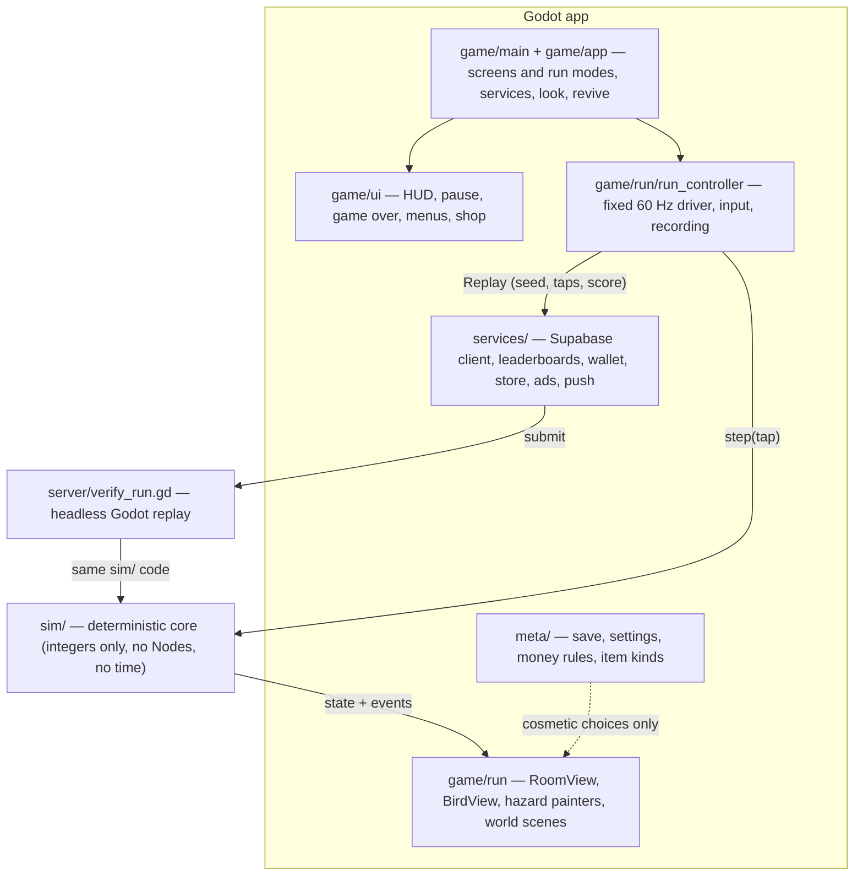

# Flapjaw — Architecture

Godot 4 (GDScript), portrait mobile game for iOS and Android, with verified
leaderboards that re-simulate every submitted run on a server.

The whole design follows from one requirement: **a run is fully described by
`(gameplay_version, seed, tap ticks)`**. Same inputs give the same score on every
phone and on the server. Everything else (art, characters, themes, sound, menus)
is presentation that can never change the outcome.

Class diagrams for rooms, obstacles, themes, cosmetics, meta and server:
[DOMAIN_MODEL.md](DOMAIN_MODEL.md).

## Layers



| Folder | Owns | May depend on | Must never |
|---|---|---|---|
| `sim/` | Physics, collision, room generation, scoring, RNG, replay/verify | nothing outside `sim/` | Use floats, `Vector2`, `randf/randi`, `Time`, `OS`, `Engine`, Nodes, frame delta, character/theme data or skins |
| `meta/` | The save and the rules about money: `Profile` (gold, diamonds, owned and equipped ids, rooms met, per-room reached, cleared and death counts, the leaderboard name) with its parts `PlayerSettings` (the Settings sheet) and `DailyRevives`; `ItemKind` (the kinds and the free starters); `PlayerName` + `NameFilter` (leaderboard name rules); `SafeFile` (crash-proof JSON saves with a backup); `RunRecord` + `RunHistory` (Your runs: the last 100 runs and up to 20 saved, never dropped); `Economy` (1 diamond = 100 gold, one way; daily top-10 prizes), `DiamondPacks`, `SeasonCalendar` | `sim/` | Change gameplay; know how anything looks |
| `services/` | `LeaderboardService`, `WalletService`, `StoreService`, `AdsService`, `PushService`: each base class is the offline stand-in, with `Sample*`/`Fake*` and the real ones beside it. `SupabaseClient` is the one Supabase connection (session, device key, database calls) that `SupabaseLeaderboard`, `SupabaseWallet`, `ProfileSync` and push share. `RunStore` keeps Your runs in `user://runs.json` | `sim/`, `meta/` | Hold game rules; grant diamonds without the store's confirmation |
| `game/` | Scenes, drawing, input, audio, haptics, UI. `game/cosmetics/`: `Catalog` (every look by kind), `Shop` (prices), `Checkout` (buying and converting through the wallet), the style + painter pairs. `game/app/`: `AppServices`, `RunLook`, `ReviveFlow`, `BoardAlerts` | `sim/`, `meta/`, `services/` | Write to sim state; put gameplay rules here |
| `data/` | `design/`: the design kit's tokens + extra palettes and worlds; `themes/`: generated `ThemeDef` per world. Later: characters, hats, trails | — | Hold hitbox or physics values |
| `assets/` | SVG icons and UI art, fonts | — | — |
| `server/` | Headless verifier; later the cloud wrapper around it | `sim/`, `meta/` | Fork the sim (it runs the same files) |
| `tests/` | Unit tests, golden replays, bot simulations | everything | — |
| `tools/` | `check.ps1`, CI helpers, golden-replay generator | everything | — |

`tests/unit/test_sim_purity.gd` enforces the `sim/` rules and
`tests/unit/test_layers.gd` the "may depend on" column (sim -> meta -> services
-> game) by scanning the source, so breaking them fails the check script.

## Deterministic core (`sim/`)

- **Fixed tick**: 60 ticks/second. `GameSim.step(tap: bool)` advances exactly one
  tick. The sim has no idea how much real time passed.
- **Integer math only**: positions and velocities are integers in sub-units
  (`SimConfig.SUB = 64` per logical pixel). Integer math gives the same result on
  every CPU; floating point and trig functions are not guaranteed to.
- **Own RNG**: `SimRng` is xoshiro128** on 32-bit masked ints, seeded from the run
  seed. The draw order is part of the gameplay rules. A cross-language reference
  test pins its output.
- **Same seed, same run** (next gameplay version): two players of one seed who
  take the same portals get the same rooms, variants, hazards, wall spikes and
  exits, however they fly. Generation never reads the bird:
  - A spine RNG (`GameSim._spine`) draws only each room's kind and seed, a fixed
    number of draws per portal. The room's own RNG lays it out, and every wall
    after the arrival's reseeds from the room seed and the wall's number
    (`RoomRuntime.rng_seed`, `walls`). A coin taken or not, or any other
    difference inside a room never reaches the next wall or room. A revive puts
    the whole run back as the bird came into the room, score, coins and RNGs
    included ([REVIVE.md](REVIVE.md)), so it never reaches them either.
  - `SimState.anchor_y` stands in for the bird's height wherever generation
    used it: room and variant picks out of a portal, the free run near the
    bird (`RoomRules.gap_reach`), hazards aimed at the arrival
    (`FairLanes.entry_y`, `arrival_path`), on-bounce draws (Stalactite Run, Lava
    Rise, Caterpillar Crawl) and short-reach exits. Out of a portal the anchor is
    the centre of the exit taken (the bird is within `EXIT_FIT` of it). At a
    bounce it moves to the point of that wall's free run nearest it, or nearest
    the room's exit for the last `GameSim.EXIT_STEER` bounces. A new wall keeps
    its free run within reach of every free spot of the wall before when they
    are close enough together, else near the anchor.
  - A room's exits are picked when it starts (`ExitPlanner.plan_room`, one per
    wall, from the room seed). The ghost and the open exit only show them, and
    their zone is reserved all room (`ExitPlanner.reserved`). Hazards that move
    keep the way open for when the bird gets there (`GameSim.steps_to_exit`).
  - Out of every portal the bird and room wait `SimConfig.PORTAL_HOLD` ticks
    (0.5 s), part of the 1 s `ARRIVAL_BLIND`. Each layout try is checked for a
    bird anywhere in the exit it came through (`GameSim.ARRIVAL_HEIGHTS`: the
    centre, ±EXIT_FIT/2 and ±EXIT_FIT). When no try is fair at every height,
    the room waits the whole `ARRIVAL_BLIND` instead (about 4% of arrivals,
    mostly Shutter Gates). The arrival check then allows no arrival with no
    way to live at 1 s (`ArrivalBench.MAX_NO_WAY = 0`, with the bird anywhere
    in the exit, `ArrivalBench.OFFSETS`).
  - Behaviour that follows the bird (Stalker, a Dart's aim, Echo) stays: it uses
    no RNG that later generation shares.
  - Tests: `tests/unit/test_same_seed.gd`, `tests/sim/test_exits_reachable.gd`, and
    the FastSim check `reach`.
- **World**: 360 × 640 logical pixels. Ceiling and floor are always deadly. Side
  walls have 13 spike slots stored as bitmasks (`left_spikes`, `right_spikes`).
- **Loop**: bird flies sideways at constant speed, a tap sets an upward velocity,
  gravity pulls down. Hitting a side wall scores a point, clears that wall and
  generates spikes on the opposite wall. Every 10 points the run moves to a new
  room kind.
- **Room generation** (`RoomRules`) always leaves a guaranteed gap of free slots.
  The spike count grows with score.
- **Events**: each step fills `GameSim.events` (`START`, `FLAP`, `BOUNCE`,
  `SCORE`, `ROOM_CHANGE`, `DEATH`). The view layer turns these into sound,
  haptics, particles and screen shake. The sim never calls out.
- **Checksum**: `SimState.checksum()` hashes the full state. Golden replays store
  it, so even a change that keeps the score but moves the bird is caught.
- **Same hitbox for every character**: character and theme never enter the sim,
  so scores stay comparable and replays don't depend on cosmetics.

### Rooms

Every 10 points an exit portal opens, always on the right wall
(`SimConfig.EXIT_WALL`: the wall a bird out of a portal
heads to, so a bird the Bumper Cloud turned back still leaves the room the same
way as every other player of the seed, after one more crossing at most; a
random spike slot; no spikes in the opening, and the whole spike-free gap
around the portal leads through, so there is no strip to bounce in beside it). Flying into it moves to the next room;
missing it is a normal bounce and it stays open. The bird comes out of a portal
in the opposite wall of the new room at the same height and keeps flying the
same way (gameplay version 6), after a 0.5 s wait (`PORTAL_HOLD`, next version;
see "Same seed, same run" above). The room is
laid out for a player who is still reading it (gameplay version 18; it replaced
a frozen wait and then a slow-motion entrance): `ArrivalCheck` plays the
arrival on copies of the sim (`SimCopy`), the bird only holding its height for
`SimConfig.ARRIVAL_BLIND` ticks (1 s, gameplay version 19) and then a few simple players trying
to live `ARRIVAL_FOLLOW` ticks more. If fewer than two do, the layout is drawn again, up to
`ARRIVAL_TRIES` times (each retry skips one RNG draw, so the seed still decides
everything and replays match). Rooms also keep the way out of a portal fair: Floating Isles
keeps the lane in front of it clear (200 px), Pinwheel
and Saw Ring move off the bird's height, Ghost Doors time their fade for it,
Bee Line, Bat Loop, Lantern Swing and Ghost Doors time themselves to the path
of a player holding height (`FairLanes.arrival_path`), Shutter Gates has its gap
at the bird's height when it gets there, and a wall the bird reaches while
still reading (fast or narrow rooms) keeps that player's hops free of spikes.
The bird comes out at least `SimConfig.ARRIVAL_EDGE` from the ceiling and
floor lines, so holding height never hops into them. A hand-made (STATIC)
variant that can't work at some height skips it (`RoomVariant.arrival_skip`,
or `RoomDef.arrival_skip` for the whole room): out of a portal the room only
draws variants that fit, so each Lantern Swing variant skips the heights
where its lanterns hang lowest. Rooms that used to skip heights now build
GENERATED variants round the arrival instead (see "Generated variants"
below), so they fit every height. `tools/arrival_test.gd` and `tools/arrival_room.gd`
measure how often a player who reacts late dies right after a portal.
The reaction benchmark: a player who needs 0.75 s is never killed by a
portal (every death there still had a way to live: `SurvivalSearch` finds
one), and a 1 s reaction may cost at most 2% of portal arrivals over an
instant one (`ArrivalBench`, checked over every room and variant by
`tools/fastsim.ps1 -Mode check -Check arrival`, part of the check; the full
benchmark with the full bot's death rate after changing a room:
`tools/fastsim.ps1 -Mode reaction`, and `-Mode odds` for
survival by reaction time in real runs; `-Variant <id>|all` plays one room
variant, or each in turn, instead of the drawn one: see
`tools/fastsim-rs/PORTING.md`). Every 50 points a
fork offers a Calm and a Wild exit. Both lead to the same door
(`SimConfig.FORK_DOOR_Y`) of the same next room, so two players on one seed
meet the same map again whichever they took: Wild pays `WILD_COINS` (5) and
that one room has `WILD_SPIKES` more spikes on every wall after the arrival's
(`SimState.route` says which exit led into the room). The next room is
picked by the seed
(`RoomCatalog.pick_next`, a shuffle bag kept in `SimState.deck_lo/hi`: a drawn
room waits until the bag refills, which it does once what is left weighs under
`DECK_REFILL_PCT` of the allowed rooms; among the rest the pick is by each
room's weight at this score, `RoomDef.pace`, a curve from its difficulty tier in
`sim/rooms/room_pacing.gd`; never the current room, only rooms whose season
matches the run's; `tools/room_odds.gd` prints the odds per score band). The exit at
every 100 points leads into a boss room instead (no fork there; the boss's
own exit, 20 bounces later, is the fork): see [BOSS_ROOMS.md](BOSS_ROOMS.md).

Fairness is checked by `tests/support/survival_search.gd` (SurvivalSearch): it
runs many copies of the sim side by side, tapping and waiting on each, so if all
of them die, no player could have lived. `tools/sweep.ps1` runs it (or the
PlannerBot playtests in `tools/playtest.gd`) over many seeds on every CPU core;
the check's `rescued` FastSim check keeps the rooms it once caught fixed.
In the check, bots only ever play on FastSim (step 6 of the quality gate);
the GDScript bots stay as the reference that parity holds FastSim's to.

Fairness rules that came out of it (gameplay version 6): in rooms with hazards
the wall's free run lands within `RoomRules.GAP_REACH` of the bird; hazards
placed at room start keep off the bird's first, forced hop
(`FairLanes.start_path`) and, where they can, out of a hover lane in front of it
(`FairLanes.blocks_start_lane`); paired columns (stalactites, gates) keep their
gaps close and clear the wall ahead near them; the open first room is only the
start and never comes back.

- `sim/rooms/room_pacing.gd` (RoomPacing): each room's tier (from its measured
  difficulty, docs/ROOM_DIFFICULTY.md) and so its unlock score and pick weight
  over the score. Re-tier rooms there after re-measuring.
- `sim/rooms/room_def.gd` (RoomDef): what a room is: group, from_score, pace,
  season, wall rules (spike count/gap, tide, blink, squeeze), gravity, speed,
  and the hazards it builds (factories, or variants drawn at room start).
  Double Trouble (two known hazards in one room) was taken out; its combo
  support (`RoomDef.combos`, `Piston.share_band`, `Beam.yields`) is unused.
- `sim/rooms/catalog_*.gd`: rooms in batches (core, motion, machines, sky,
  seasonal, twists, boss). `RoomCatalog.BATCHES` fixes the order; append new
  batches at the end.
- `sim/rooms/room_runtime.gd` (RoomRuntime): the live room: steps, points,
  wall position and spike masks over time, steps per tick (fast/slow rooms).
- `sim/rooms/hazard.gd` (Hazard) and `sim/hazards/*.gd`: one class per
  obstacle (setup/step/kills/touch/adjust_wall/on_bounce/on_flap/blocks_exit/
  guards_edge/wall_shift/locks_exit/checksum). Integer, tick-driven, so
  replays verify. A hazard that keeps a spot on a new wall clear of itself
  returns the mask from `adjust_wall`; it never writes the wall spikes itself.
  `wall_shift` slides a wall's spikes along it (Spike Belt: collision and the
  view both read `GameSim.wall_shift`); `locks_exit` turns an open exit into a
  bounce (Locked Out). A hazard in a room with variants may read
  `room.variant_id()` in `setup()` instead of each variant adding its own.
  A hazard that announces its danger (a glow, a marked column, a dashed line)
  also reports that tell in `warnings()`: the box the danger will cover, the
  steps until it starts (`eta`), the steps it lasts and whether it kills or
  only pushes (`Hazard.WARN_SIZE` ints each; `GameSim.warnings()` gathers them).
  That is the bots' one shared reading of tells (BlindPlanner's human
  reaction and the human tiers; `docs/BOT_SIGHT.md`). It reports only
  what the painter draws, reads only, draws nothing from the RNG and is not in
  the checksum, so it never changes a run. A new hazard with a tell must add
  it: `tests/unit/test_warnings.gd` fails otherwise, and FastSim-RS parity
  fails until its Rust copy reports the same.
- `sim/fair_lanes.gd` (FairLanes): where a bird that just started or came out
  of a portal will fly; hazards placed at room start keep off it.
- `sim/exit_planner.gd` (ExitPlanner): where exits go. GameSim decides when.
  It never puts an exit where a hazard kills in its mouth already
  (`ExitPlanner.in_mouth`) or says it would (`Hazard.blocks_exit`).
- `sim/exit_zone.gd` (ExitZone): the mouth of a drawn exit (the opening plus
  a bird radius around it, three bird radii deep), from its ghost (or its
  opening) until the bird leaves the room. Where a room's exits go is planned
  from its seed when it starts (`ExitPlanner.plan_room`), so every player of a
  seed meets the same exits, but hazards only respect a mouth once it is drawn
  (the plan is hidden, so a bot or player can't read it from the hazards).
  Hazards treat a mouth as part of the wall: balls bounce off it, the Stalker
  stops at its edge, the Echo keeps out, darts, drops, crates and sparks break
  on it, pistons move off its row or sit the cycle out, and beams stop short.
  Whatever is in a mouth when it is drawn gets out on the next step (bounces
  out, jumps clear, breaks, pulls back). Fixed rams and swinging lanterns
  can't, so an exit is never planned where they reach (`blocks_exit`). Wall
  spikes may cover a mouth until its exit's ghost shows.
  `tools/fastsim.ps1 -Mode check -Check exits` (every variant, and full runs in
  every season, each played twice with different taps) checks that both plays
  meet the same exits, that nothing kills in or turns the bird back from a
  drawn mouth, and that no spike reaches into it; `tests/sim/test_exit_clear.gd`
  keeps a sample.
- `game/run/hazard_layer.gd` + `game/run/painters/<kind>_painter.gd`: one
  `HazardPainter` per hazard kind, which casts the hazard to its own class and
  gets a `HazardLook` (world, clock, the room's skin, color-blind mode).
  Deadly parts in the world's spike color only.
- Skins (a seasonal room drawing a year-round hazard differently) are looks
  only: `game/rooms/room_skins.gd` maps room id to skin. The sim never sees
  them.
- Seasons (`sim/rooms/seasons.gd`) are a run input: `meta/season_calendar.gd`
  maps today's date to a season, `GameSim`/`Replay` store it.

Adding a room: write the hazard (or reuse one) and port it to
`tools/fastsim-rs` (`tools/fastsim-rs/PORTING.md`), its painter, a RoomDef in
a batch file, its name in `RoomInfo` (and a skin in `RoomSkins` if it reuses a hazard's look), and
tests; bump `GAMEPLAY_VERSION` and regenerate goldens.

### Generated variants

A room has one or more variants (`RoomVariant`), one drawn when the room
starts. Each is **STATIC** (hand made: fixed hazard factories, `with()`) or
**GENERATED** (`generated(recipe)`: a recipe builds the layout when the room
starts). Static variants are set up exactly as before; generated ones go
through `RoomRuntime._generate`:

1. **Parameters** (`sim/rooms/variant_params.gd`, `VariantParams`): the
   room RNG; the PLANNED entry height `entry_y` (out of a portal
   `SimState.anchor_y`, the centre of the exit taken, from the seed, never
   the bird's own height: the same-seed rule and 1v1 depend on it) and its
   `spread` (`EXIT_FIT`, the bird comes out within it); the band a bird
   holding its height there sweeps (`hold_top`, `hold_bottom`); the score and
   its level (one per `BOSS_EVERY` points), so a recipe can scale; the try
   number and `fallback`.
2. **Generate**: the recipe builds its hazards into the room with `p.add()`
   (each set up from the room RNG, in order) and may shape them round the
   entry (Shutter Gates and Stalactite Run open their gaps round the hold
   band until the bird is past: `open_for_arrival`, closing at a slide the
   painter draws as it kills; Echo's mirror draws the height it turns round
   away from the band; Bee Line draws its wave's height).
3. **Check** (`sim/rooms/variant_check.gd`, `VariantCheck.holds`): on
   copies, a bird at each `GameSim.ARRIVAL_HEIGHTS` height of the exit only
   holds its height for `HOLD_STEPS` moving steps (`ARRIVAL_BLIND`; longer
   with `hold_steps`, e.g. Crate Drop and Spike Rain, whose first drop falls
   after the reading time). What the hazards do to it acts on it (`touch`:
   air lifts it, a bubble carries it), and it may touch nothing deadly, nor
   the ceiling or floor (with `avoid_touch` not even a bubble). No draws, the
   room is left as it is.
4. **Retry**: on a fail the layout is thrown away and built again from the
   next draws, up to `RoomVariant.GENERATE_TRIES` (8) times. The last try is
   the recipe's **safe fallback** (`p.fallback`), kept unchecked: safe by
   construction (islands in the band left out, crawlers moved to the far
   edge, bubbles started under the floor, the first crate or drop held back,
   the bee wave at the far end of its range, Updraft's air cut short of the
   band; a gust starts at the top of its rest), or a fixed search with no draws that keeps the first layout the
   check passes (Pinwheel: heights clear of the band x starting angles, a
   twin pair drawn closer; Lantern Swing: each chain moved to clear the band,
   its pivot moved in to stay inside the room, the winch wound less; Bramble
   Ball: start heights x headings).

**Hard rule: a generated room is always the same for a seed.** A recipe (and
its check and fallback) may only use the room's RNG, which is seeded from the
run seed and the room's place in the run (`GameSim._spine`), and parameters
that come from the seed: the planned entry height `anchor_y`, the score at
the room start and its level. Never the bird's real height, its speed, the
tick it came in on, its taps, the fork it took, coins or anything else a
player does. `VariantCheck` flies its own birds from `anchor_y` and leaves
the sim as it was. Checked by `tests/unit/test_generated_variants.gd` (each
seed played twice with different taps, every generated room both plays meet
built the same, hazard positions and sizes included; a bird anywhere in the
exit; Calm or Wild at a fork) and by the `sameseed` FastSim check (every
generated variant, five exit heights, both ways in, Calm and Wild).

**Hard rule: the layout never changes once the bird is in the room.** A
recipe builds the layout once, at room start (fallbacks and searches
included), and nothing reshapes it afterwards. Allowed during the room: the
hazards' own visible, predictable motion, as hand-made variants have (a swing,
a turning wheel, a falling drop, a gap that slides on each bounce), and the
usual wall spikes per bounce. `test_generated_layouts_stay_fixed_while_the_bird_is_in_the_room`
checks it: per hazard kind it declares the fields that make the layout
(`LAYOUT_FIELDS`); they must not change at any later tick. Shutter Gates and
Stalactite Run are still being reworked to a fixed layout (their arrival
opening closes after the bird is past; `PENDING_FIXED`).

The rest of the fairness contract is the same for every room: the way on
after the hold is ArrivalCheck's (`GameSim._arrival_retries`, which may still
lay the room out again: a generated variant drawn by the room seed's first
draw stays then, so its share is what the variant list says, and only its
layout is drawn again), the planned exits stay reachable and clear
(`ExitPlanner`, `blocks_exit`: an arrival opening is left out there, it
closes), and every hazard keeps its own warnings. A generated variant needs
no `arrival_skip`. Floating Isles is the reference recipe
(`catalog_core.gd`, `_gen_isles`). Generated today: Floating Isles, Shutter
Gates, Caterpillar Crawl and Crab Walk, Stalactite Run (every variant),
Bubble Lift, Echo (mirror), Gift Stack, Bee Line, Updraft, Pinwheel, Lantern
Swing, Crate Drop, Bramble Ball and Spike Rain (every variant). Hand made on
purpose: Saw Ring, Piston Press, Beam Gates and the rest.
`tests/unit/test_generated_variants.gd` checks the contract at every height;
`fastsim-rs variants [arrivals] [rooms]` measures each variant's real share
out of a portal, the full-wait rate and deaths within 2 s.

### Gameplay versions

`SimConfig.GAMEPLAY_VERSION` (its log of changes is in `sim/sim_config.gd`) goes up whenever movement,
collision, generation or RNG draw order changes. Golden replays then fail on
purpose. Regenerate them with `tools/make_golden.gd` only after bumping the
version.

When live builds exist, the server must keep replaying older versions that are
still allowed. Plan: before changing the sim, freeze the current files into
`sim/versions/g<N>/` (class names suffixed, e.g. `GameSimG1`), and have
`server/verify_run.gd` dispatch on `gameplay_version`. Retired versions are
rejected and the player is asked to update. Not needed until the first release.

## Client run loop (`game/`)

```
_unhandled_input   tap  -> _tap_pending = true
_physics_process   (60 Hz, fixed)
    tap = _tap_pending; _tap_pending = false
    if tap: replay.taps.append(sim.state.tick)
    sim.step(tap)
    for e in sim.events: emit signals  -> HUD, audio, haptics, VFX
_process           views draw, interpolating between previous and current tick
```

- `RunController` (Node) owns the `GameSim` and the `Replay` being recorded. It is
  the only place that touches the sim.
- `game/main.gd` wires the app together and moves between screens and run
  modes (menu, run, practice, replay). The parts it wires: `AppServices` (the
  services, made once and handed to the screens that need them: no service
  globals), `RunLook` (the flyer, world, trail, crash, portal and music in the
  live room; borrowed during a replay), `ReviveFlow` (the revive offer, free
  or for an ad), `BoardAlerts` (the daily prize spot and push alerts), and
  the HUD with its `PauseScreen` and `GameOverScreen`. At game over
  `GameOverStage` empties the room behind that screen (hazards, coins, trail,
  crash effect and cage spikes fade; the sky and landscape stay) and floats
  the flyer to the middle, big and dazed; a new run brings it all back.
- Each world's look beyond its colours is one file,
  `game/run/scenes/worlds/<id>.gd` (a `WorldScene`): its landscape, what falls
  through its sky and its touch on a Match my world portal. A world without one
  gets `generic.gd`.
- `RoomView` / `BirdView` read `sim.state` and draw. Rooms are drawn
  procedurally in the "Soft light" style (gradient sky with blurred patches of
  its own sky stops, one glow bloom, drifting particles, rounded two-tone
  spikes; the ceiling and floor rows are unbroken and reach the kill lines).
  Menus and HUD use the minimal kit (`UiTheme`): ink text straight on the room,
  flat cream cards only for grids and forms, one round main button per screen,
  the cradle dock on Home and Game over, Archivo as the only font. Real sprites
  replace the drawing later without touching the sim.
- Pause just stops calling `step()`. The app auto-pauses when it loses focus.
- Display: 360 × 640 viewport, `canvas_items` stretch with `expand` aspect (no black bars; `game/style/screen_layout.gd` puts the fixed 360 × 640 room at the top of the safe area, centred sideways, and RoomView fills around it), portrait, Compatibility
  renderer (best for 2D on older phones).

## Verified leaderboards

Live now (supabase/migrations/20261109120000_verified_runs.sql):

1. The client plays and records tap ticks (`Replay`).
2. On game over it sends `submit_run` the score, coins, end tick, season, seed and
   taps. The run is stored as `pending`.
3. When a run arrives (the database starts it,
   supabase/migrations/20261109210000_wake_checker.sql) and every 10 minutes as
   a safety net, `.github/workflows/verify-runs.yml` fetches pending runs
   (`worker_pending_runs`), replays them with `server/verify_batch.gd`
   (`RunChecker` -> `Replay.verify()`, the same `sim/` code) and writes back
   `worker_record_results`.
4. Same score, coins and end tick, and a season that was in play that day: `ok`.
   Anything else: `rejected`. An older gameplay version: `outdated`. A newer one
   than the checker's stays pending until main has that sim.
5. Boards show `ok` runs to everyone, plus the caller's own `pending` runs (so a
   new best shows at once on that phone). Rejected runs never show and can't be
   watched.

Still to come: server-issued one-time seeds (so a run can't be searched for
offline), frozen older sims so older app versions keep verifying (the
`sim/versions/g<N>/` plan above), plausibility checks (tap speed, timing
variance, jumps above the player's history) with a review queue, and App
Attest / Play Integrity to confirm a real device.

## Feature map (your picks)

| Pick | Where it lives |
|---|---|
| Sunset Glow art, Smooth classic spikes | `game/style/`, `data/themes/*.tres` (generated from `data/design/`) |
| Flyers (hats and accessories later) | `data/flyers/` (`CharacterDef`), drawn by `BirdView`; never in `sim/` |
| Bird trails (buyable cosmetic) | `TrailStyle` + `TrailView` + `TrailPainter` |
| Exit portal looks (buyable cosmetic) | `PortalStyle` (one entry in `STYLES`) + `PortalPainter` (one draw function per kind; a world's rim touch comes from its `WorldScene`); never changes the exit size |
| Flap trails (buyable cosmetic) | Ten `TrailStyle`s with `stamp_on_flap`: one stamp where each flap happened (`TrailStyle.flap_trails()`, shapes in `TrailPainter`) |
| Crash effects (buyable cosmetic) | `CrashStyle` (one row in `STYLES`) + `CrashPainter` (one draw function per kind) + `CrashView`; starts after the sim has ended the run and only knows where the flyer was drawn |
| Name plates (buyable cosmetic) | `PlateStyle` + `PlatePainter`, drawn behind a `LeaderboardRow`. The plate goes along in a run's loadout; `get_board` returns it per row (migration `20261110095000_board_plates.sql`) |
| Customize | `LookScreen` ("Your look": one `LookCard` per kind with what is in use) opens a kind's list, `CollectionScreen` (titled by the kind, no tabs): a `LookPreview` on the room, the `ItemCard` grid, and an `ItemPopup` whose action comes from `ItemOffer` (words from `ItemText`, music previews from `MusicPreview`, buying through `Checkout`); its Back returns to the overview |
| Designed UI (game over, menus, buttons) | SVGs in `assets/ui/` + one shared UI `Theme` resource ([BACKLOG](BACKLOG.md)) |
| Worlds | `data/design/` (tokens) -> `data/themes/` (generated `ThemeDef`), `game/run/scenes/worlds/<id>.gd` (`WorldScene`) |
| Pause button | `game/ui/hud` + `RunController.set_paused()` |
| Daily board | Best normal run of the day, resets at local midnight (replaced Hourly; the same-seed daily challenge was dropped) |
| Boss rooms | `sim/rooms/catalog_boss.gd` (RoomDef.boss), a hazard extending `sim/hazards/boss.gd` (phases, tells, down), its painter, `RoomInfo`; see [BOSS_ROOMS.md](BOSS_ROOMS.md) |
| Seasonal rooms | `sim/rooms/catalog_seasonal.gd`, `meta/season_calendar.gd` (season is a run input) |
| Haptics and sound | `game/audio/audio_director.gd` listening to the run's signals; haptics in `game/main.gd` |
| Accessibility | `meta/player_settings.gd` (`PlayerSettings`); color-blind spikes, reduced flashing and screen shake in the view. A larger tap area is input-only. No hitbox changes |
| Fair monetization | `services/ads_service.gd` (rewarded revive only, `game/app/revive_flow.gd`), `game/cosmetics/shop.gd` + `checkout.gd` (cosmetics only), the Revive Pass in `meta/diamond_packs.gd` (ad-free revives, still one per run: [REVIVE.md](REVIVE.md)) |
| Your runs | `meta/run_history.gd` + `run_record.gd` (limits, version check), `services/run_store.gd` (the file), `game/ui/screens/runs_screen.gd`, Home's card; Watch uses the leaderboard replay path (`main.watch_run` -> `play_replay`) |
| Earn diamonds | `meta/earn_rules.gd` (milestones, streak; the daily tiers stay in `Economy`), `services/earn_status.gd` (`WalletService.earn_status()`, from `get_earn_status` in migration `20261111100000_earn_status.sql`, the last answer or a guess from the save offline), `game/ui/screens/earn_screen.gd`; opens from the wallet on Home, Your look and Customize lists, and from the prize popup's link |
| Verified leaderboards | `sim/replay.gd`, `server/`, `services/leaderboard_client.gd` (`LeaderboardService`), `services/supabase_*.gd`, `game/ui/screens/leaderboard_screen.gd` |

A revive changes the run, so it must be recorded in the replay (a `revive_tick`
input) and replayed by the server. The design draft is in [REVIVE.md](REVIVE.md).

To see what ads and notifications do on a real phone, the settings sheet has a
hidden debug page: [DEBUG.md](DEBUG.md).

## Quality gate

`tools/check.ps1` must pass before any change counts as done. Its steps run
side by side where they can: lint, format and the FastSim checks start at
once (they need no Godot), and after the import the tests, the load step and
the parity recording run together; each step's output is shown under its own
heading. About 20 s at `-Jobs 8`.

1. **Lint and format**: `gdlint` and `gdformat --check` (gdtoolkit). Without
   gdtoolkit the check fails.
2. **Import**: `godot --headless --import` builds the class cache.
3. **Load all**: every script and scene under `res://` loads without errors.
4. **Tests** (`tests/run_tests.gd`, a small in-repo runner with no addon):
   unit tests, sim purity scan, golden replays, and rule checks on rooms
   (layouts, exits, hazards). No bot plays here: every bot test runs on
   FastSim (step 6). (A few unit tests use the cheap gap seeker only to make
   a run for replay, run checker and UI code that only GDScript has.)
   The check runs them side by side in headless worker processes
   (`--jobs N`; `check.ps1` uses one per core, at most 8): each worker claims the next piece of work, a
   whole test file by default, so tests sharing a save file stay together.
   Bot test files mark `const PARALLEL := true` (each method a piece), and the
   slowest methods take `(part, parts)` with `const PARTS := n`, each part
   doing its share of the rooms or seeds; a `combine_` function then checks
   totals over all parts. Pieces start longest first, from the last run's times.
5. **FastSim-RS parity**: `tools/fastsim-rs` (the Rust copy of `sim/` for
   fast bots, `docs/FASTSIM_RS.md`) replays runs recorded by
   `tools/fastsim_parity.gd` and must match tick for tick: every room in
   practice and in full runs in every season, every room variant forced, a portal arrival into every room variant, a revive in every
   room, every other sim the checks start from (`tests/support/bot_setups.gd`);
   and its bots and searches (gap seeker, random tapper, the light PlannerBot,
   SurvivalSearch, QuickSearch) must choose the same taps. This is what ties
   step 6 to the real game code. Without Rust (cargo) the check fails.
6. **FastSim checks** (`tools/fastsim.ps1 -Mode check`,
   `tools/fastsim-rs/fastsim/src/checks/`):
   every test that plays a bot, with the rules and thresholds the GDScript
   tests they replaced had, on more seeds: every variant passable, the portal
   reaction benchmark, the points cap, revives in every room and exit case,
   the crawl, gates and isles searches, the once
   impossible rooms, and random-tapper and gap-seeker runs (the list:
   `tools/fastsim-rs/PORTING.md`). `-TestFilter` picks the checks it names or
   whose old test path it matches; `-FastSimJobs` sets the workers (default
   `-Jobs`). CI runs steps 5 and 6 too (`.github/workflows/check.yml`).

Retired bots: WorldPlanner (the world model), the MPC bot, the RL bot (policy,
training, imitation, PPO, DAgger), HumanBot and Reflex (the old reflex human
bot) and honest-v1 were removed with the C# FastSim on 2026-11-12, with their
checks (rlbot, rlboss, mpcbot, mpcboss). Their docs, code and research are in
the git history and in `D:\SoftwareProjects\SpikeCage-coord\research`. The
bots that stay (BlindPlanner, the human tiers, the yardstick) run on
FastSim-RS.

The database has its own tests (`tools/db_test.ps1`, needs Docker; CI runs
them in `.github/workflows/supabase-db.yml`).

Planned later: a search-based solvability check per generated room and
screenshot comparisons of key screens. Both need rendering, so they run outside
plain headless mode.

## Milestones

- **Phase 1, core loop** (done): deterministic sim, 3 room kinds, room
  change every 10 points, Sunset Glow placeholder art, pause, restart.
- **Phase 2, content**: 6 themes, moving obstacles, coins, feathers and stars,
  6 characters with hats, save file, sound and haptics, accessibility settings.
- **Phase 3, progression**: achievements, ranks, seed server, verified boards
  (daily, tiers, all-time, friends), boss rooms, seasonal events, ghosts.
- **Phase 4, launch**: Android and iOS export, store accounts, listing,
  privacy policy.
