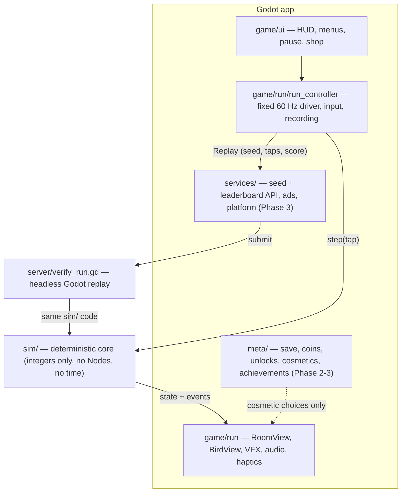

# Spike Cage — Architecture

Godot 4 (GDScript), portrait mobile game for iOS and Android, with verified
leaderboards that re-simulate every submitted run on a server.

The whole design follows from one requirement: **a run is fully described by
`(gameplay_version, seed, tap ticks)`**. Same inputs give the same score on every
phone and on the server. Everything else (art, characters, themes, sound, menus)
is presentation that can never change the outcome.

Class diagrams for rooms, obstacles, themes, cosmetics, meta and server:
[DOMAIN_MODEL.md](DOMAIN_MODEL.md).

## Layers



| Folder | Owns | May depend on | Must never |
|---|---|---|---|
| `sim/` | Physics, collision, room generation, scoring, RNG, replay/verify | nothing outside `sim/` | Use floats, `Vector2`, `randf/randi`, `Time`, `OS`, `Engine`, Nodes, frame delta, character/theme data |
| `game/` | Scenes, drawing, input, audio, haptics, UI | `sim/`, `meta/`, `services/` | Write to sim state; put gameplay rules here |
| `meta/` (later) | Save file, wallet, unlocks, cosmetics, achievements, ranks | `sim/` (read events) | Change gameplay |
| `services/` (later) | HTTP to seed/leaderboard server, ads, Game Center / Play Games mirror | — | Hold game rules |
| `data/` (later) | Characters, hats, themes, spike skins as `.tres` Resources | — | Hold hitbox or physics values |
| `server/` | Headless verifier; later the cloud wrapper around it | `sim/` | Fork the sim (it runs the same files) |
| `tests/` | Unit tests, golden replays, bot simulations | everything | — |
| `tools/` | `check.ps1`, CI helpers, golden-replay generator | everything | — |

`tests/unit/test_sim_purity.gd` enforces the `sim/` rules by scanning the source,
so breaking them fails the check script.

## Deterministic core (`sim/`)

- **Fixed tick**: 60 ticks/second. `GameSim.step(tap: bool)` advances exactly one
  tick. The sim has no idea how much real time passed.
- **Integer math only**: positions and velocities are integers in sub-units
  (`SimConfig.SUB = 64` per logical pixel). Integer math gives the same result on
  every CPU; floating point and trig functions are not guaranteed to.
- **Own RNG**: `SimRng` is xoshiro128** on 32-bit masked ints, seeded from the run
  seed. The draw order is part of the gameplay rules. A cross-language reference
  test pins its output.
- **World**: 360 × 640 logical pixels. Ceiling and floor are always deadly. Side
  walls have 13 spike slots stored as bitmasks (`left_spikes`, `right_spikes`).
- **Loop**: bird flies sideways at constant speed, a tap sets an upward velocity,
  gravity pulls down. Hitting a side wall scores a point, clears that wall and
  generates spikes on the opposite wall. Every 10 points the run moves to a new
  room kind.
- **Room generation** (`RoomRules`) always leaves a guaranteed gap of free slots.
  The spike count grows with score.
- **Events**: each step fills `GameSim.events` (`START`, `FLAP`, `BOUNCE`,
  `SCORE`, `ROOM_CHANGE`, `DEATH`). The view layer turns these into sound,
  haptics, particles and screen shake. The sim never calls out.
- **Checksum**: `SimState.checksum()` hashes the full state. Golden replays store
  it, so even a change that keeps the score but moves the bird is caught.
- **Same hitbox for every character**: character and theme never enter the sim,
  so scores stay comparable and replays don't depend on cosmetics.

### Gameplay versions

`SimConfig.GAMEPLAY_VERSION` (currently `1`) goes up whenever movement,
collision, generation or RNG draw order changes. Golden replays then fail on
purpose. Regenerate them with `tools/make_golden.gd` only after bumping the
version.

When live builds exist, the server must keep replaying older versions that are
still allowed. Plan: before changing the sim, freeze the current files into
`sim/versions/g<N>/` (class names suffixed, e.g. `GameSimG1`), and have
`server/verify_run.gd` dispatch on `gameplay_version`. Retired versions are
rejected and the player is asked to update. Not needed until the first release.

## Client run loop (`game/`)

```
_unhandled_input   tap  -> _tap_pending = true
_physics_process   (60 Hz, fixed)
    tap = _tap_pending; _tap_pending = false
    if tap: replay.taps.append(sim.state.tick)
    sim.step(tap)
    for e in sim.events: emit signals  -> HUD, audio, haptics, VFX
_process           views draw, interpolating between previous and current tick
```

- `RunController` (Node) owns the `GameSim` and the `Replay` being recorded. It is
  the only place that touches the sim.
- `RoomView` / `BirdView` read `sim.state` and draw. Sunset Glow is drawn
  procedurally for Phase 1 (gradient sky, sun, deep-purple smooth spikes). Real
  sprites replace it later without touching the sim.
- Pause just stops calling `step()`. The app auto-pauses when it loses focus.
- Display: 360 × 640 viewport, `canvas_items` stretch, portrait, Compatibility
  renderer (best for 2D on older phones).

## Verified leaderboards (Phase 3)

1. Client asks the server for a one-time seed (`seed_id`, expires).
2. Client plays and records tap ticks (`Replay`).
3. On game over it submits `{app_version, gameplay_version, seed_id, taps, score, end_tick, checksum}`.
4. Server runs `godot --headless -s res://server/verify_run.gd -- run.json`, which
   calls `Replay.verify()` with the same `sim/` code. That takes milliseconds.
5. Same score and end tick: accepted. Else, or reused/unknown seed, or unknown
   version: rejected. Plausibility checks (tap speed, timing variance, jumps
   above the player's history) send runs to a review queue. App Attest / Play
   Integrity confirm a real device.

Hosting candidates: Supabase or Firebase for seeds, accounts and boards, plus a
small container that runs headless Godot for verification.

## Feature map (your picks)

| Pick | Where it lives |
|---|---|
| Sunset Glow art, Smooth classic spikes | `game/style/`, later `data/themes/*.tres` |
| 6 launch characters, hats and accessories | `data/characters/`, `data/cosmetics/`, drawn by `BirdView`; never in `sim/` |
| Bird trails (buyable cosmetic) | `TrailStyle` resource + `TrailView`; shop trails as `data/trails/*.tres` ([BACKLOG](BACKLOG.md)) |
| Designed UI (game over, menus, buttons) | SVGs in `assets/ui/` + one shared UI `Theme` resource ([BACKLOG](BACKLOG.md)) |
| 6 launch themes | `data/themes/` (palette, background props, spike skin) |
| Pause button | `game/ui/hud` + `RunController.set_paused()` |
| Daily challenge room | Server hands everyone the same daily seed; own board |
| Boss rooms | New room kinds in `sim/room_rules.gd` (gameplay change, bumps version) |
| Seasonal events | `data/events/` resources that swap themes and shop items by date (server-provided date, cosmetic only) |
| Haptics and sound packs | `game/feedback/` listening to sim events; packs as resources |
| Accessibility | Settings in `meta/settings`; color-blind spike palettes, reduced flashing and screen shake in the view. A larger tap area is input-only. No hitbox changes |
| Fair monetization | `services/ads` (rewarded revive only), `meta/shop` (cosmetics only) |
| Verified leaderboards | `sim/replay.gd`, `server/`, `services/leaderboard` |

A revive changes the run, so it must be recorded in the replay (a `revive_tick`
input) and replayed by the server. Design that before adding revive.

## Quality gate

`tools/check.ps1` must pass before any change counts as done:

1. **Lint and format**: `gdlint` and `gdformat --check` (gdtoolkit), skipped with a
   warning if gdtoolkit isn't installed.
2. **Import**: `godot --headless --import` builds the class cache.
3. **Load all**: every script and scene under `res://` loads without errors.
4. **Tests** (`tests/run_tests.gd`, a small in-repo runner with no addon):
   unit tests, sim purity scan, golden replays, and bot simulations (random
   tapper for crashes and invariants, plus a heuristic bot that must clear
   several rooms, as a first solvability check).

Planned later: a search-based solvability check per generated room and
screenshot comparisons of key screens. Both need rendering, so they run outside
plain headless mode.

## Milestones

- **Phase 1, core loop** (in progress): deterministic sim, 3 room kinds, room
  change every 10 points, Sunset Glow placeholder art, pause, restart.
- **Phase 2, content**: 6 themes, moving obstacles, coins, feathers and stars,
  6 characters with hats, save file, sound and haptics, accessibility settings.
- **Phase 3, progression**: achievements, ranks, seed server, verified boards
  (hourly, tiers, daily, all-time, friends), boss rooms, seasonal events, ghosts.
- **Phase 4, launch**: Android and iOS export, store accounts, listing,
  privacy policy.
