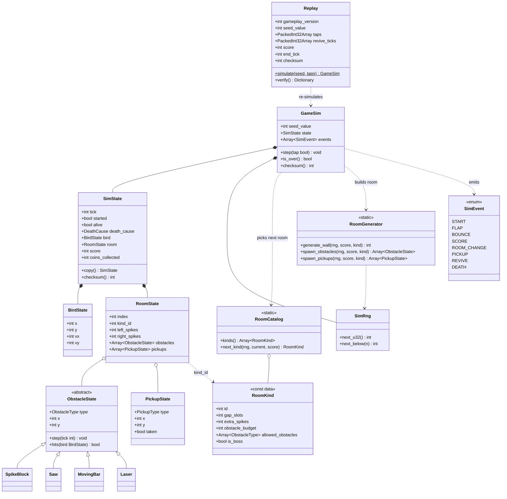
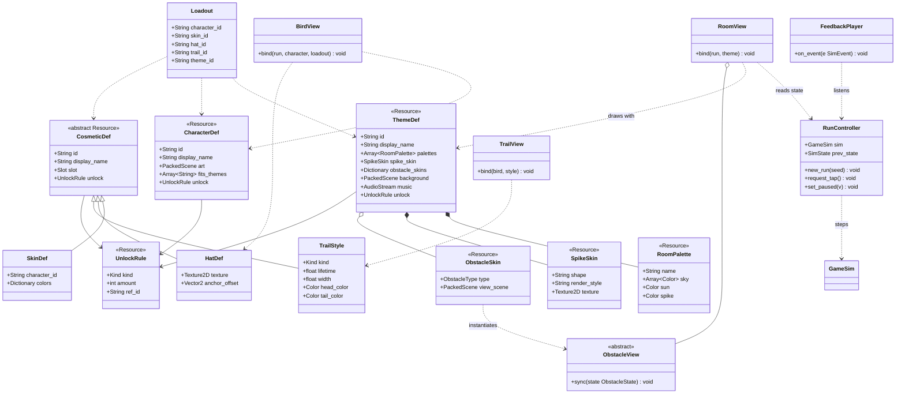
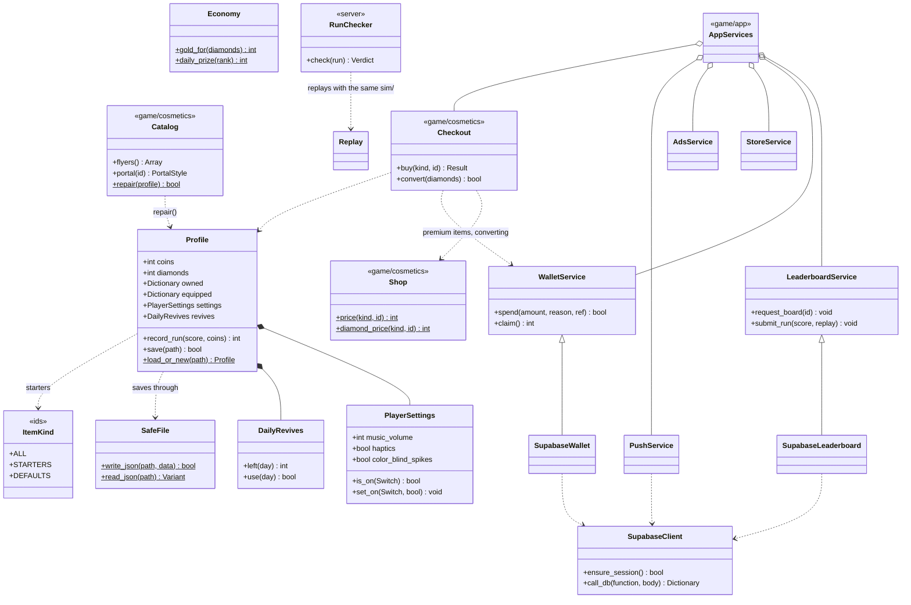

# Flapjaw — Domain Model

Class diagrams for the whole game, split by the same layers as
[ARCHITECTURE.md](ARCHITECTURE.md). Arrows only point inward: content and meta
know about the sim, the sim knows about nothing else.

Rendered images: [diagrams/](diagrams/). The Mermaid source below is the
source of truth; re-export the SVGs when you change it.

## Three words that are easy to mix up

| Term | Layer | Decided by | Changes gameplay? | Example |
|---|---|---|---|---|
| **Room kind** | `sim/` | The run seed (RNG) | Yes: gap size, spike count, obstacles, boss | "Narrow", "Saw Hall", "Boss: Crusher" |
| **Theme** (world) | `data/` + `game/` | The player, in the theme menu | No | Jungle Canopy, Ice Cavern |
| **Room palette** | `data/` + `game/` | The room index inside the chosen theme | No | Sunset Glow's Dusk, Dawn, Noon |

So one run in Ice Cavern can visit room kinds Open → Narrow → Saw Hall, each
drawn with the next Ice Cavern palette and Ice Cavern's spike and obstacle skins.
A room kind never knows which theme draws it.

## 1. Gameplay core (`sim/`)

Integers only, no Nodes, no engine time. Everything here is part of the
gameplay rules and is covered by `GAMEPLAY_VERSION`.

Notes:

- **Room flow**: on every 10th point `GameSim` asks `RoomCatalog.next_kind()`
  (never the same kind twice; a boss kind every 50 points), then
  `RoomGenerator` fills a fresh `RoomState`. On every wall bounce only the
  opposite wall's spike mask is regenerated.
- **Obstacles** move on integer paths driven by `tick` alone, so they replay
  exactly. Each type does its own integer collision against `BirdState` using
  `SimMath`. New obstacle types are added as subclasses plus a view (section 2).
- **Pickups** (coins, feathers, stars) live in the sim so collected coins are
  replay-verifiable, and the `PICKUP` event tells the view to play the effect.
- **Revive** is an input like a tap: `Replay.revive_ticks` records it so the
  server can replay it. One per run.
- **Draw order is a rule**: `RoomGenerator` must always draw from `SimRng` in the
  same order (wall, then obstacles, then pickups). Reordering is a gameplay change.

## 2. Content and presentation (`data/`, `game/`)

Content is Godot `Resource` classes saved as `.tres` files, so new characters,
themes, hats and trails are data, not code. None of it reaches the sim.

Notes:

- `RoomView` picks the palette with `theme.palettes[room.index % size]` and
  creates one `ObstacleView` per `ObstacleState`, using the theme's
  `ObstacleSkin` for that type. That's how the wooden beam becomes a steel
  girder in Star Station.
- `BirdView` draws the character, skin and hat; `TrailView` draws the trail.
  All characters use the sim's one hitbox.
- `FeedbackPlayer` turns sim events into sound, haptics, particles and screen
  shake, using the player's sound pack and accessibility settings.
- UI screens (game over, pause, shop) use SVG art and one shared UI `Theme`
  (see [BACKLOG.md](BACKLOG.md)).

## 3. Meta, services and server (`meta/`, `services/`, `server/`)

Notes:

- `Profile` is the save file (`user://profile.json`). `SafeFile` writes it to a
  temp file first and keeps the last good one as `.bak`; a broken save loads the
  backup and is kept aside, never overwritten. The `version` field goes through
  `Profile._migrate()`, and keys a newer build wrote are written back as they
  were. Equipped ids are stored as saved; `Catalog.repair()` swaps looks that
  no longer exist.
- `meta/` knows nothing about how things look: ids only (`ItemKind`). What an
  id looks like is `Catalog`, its price `Shop`, buying it `Checkout`.
- Coins earned in a run come from the sim (`SimState.coins`, checked by
  `Replay.verify()`), so rewards and leaderboards use the same verified numbers.
- Every service base class is also its offline stand-in (no boards, the local
  wallet, a closed store, no ads, no push). `AppServices` picks the real one
  when the build and setup allow it and hands the set to the screens.
- A diamond spend carries a request id, so a lost answer can be asked again
  without a second charge (`supabase/migrations/20261110140000_spend_requests.sql`).
- Planned: server-issued one-time seeds, and frozen copies of older sims
  (for example `sim/versions/g1/`) so old runs keep verifying after an update.

## Today

| Piece | Where |
|---|---|
| Bird and room state | Flat fields on `SimState`; the live room is `RoomRuntime` |
| Room kinds | `RoomDef` batches in `sim/rooms/catalog_*.gd`, picked by `RoomCatalog.pick_next` |
| Obstacles, pickups | One `Hazard` subclass each in `sim/hazards/` |
| Fairness | `FairLanes` (start and arrival lanes), `ArrivalCheck`, `ExitPlanner`, hazard hooks |
| Look | `ThemeDef` `.tres` per world (generated), `WorldScene` per world, a painter per hazard |
| Cosmetics | Style + painter pairs in `game/cosmetics/`, owned and equipped via `Profile` |
| Meta, services, server | `meta/`, `services/`, `server/run_checker.gd` (see section 3) |
